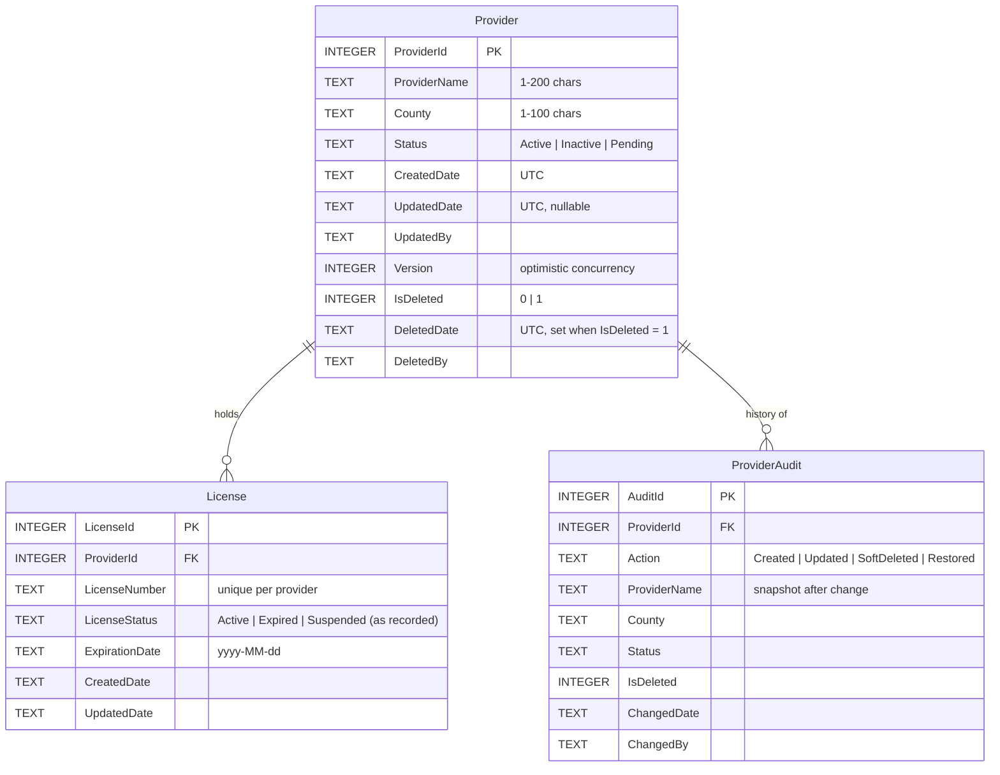

# Provider & License Manager

A small full-stack system for managing **providers** and their **licenses**. It is a React UI on top of an ASP.NET Core 8 Web API, Entity Framework Core and SQLite.

**The rule that shapes everything: records are never hard-deleted.** Deleting a provider hides it from normal use, but the row stays in the database for audit and can be restored.

| Layer | Technology |
| --- | --- |
| UI | React 19, Vite 8 (JavaScript), Recharts (dashboard charts) |
| API | ASP.NET Core Web API, C#, .NET 8 |
| Data access | Entity Framework Core 8, SQLite provider |
| Database | SQLite; the schema is owned by SQL scripts |
| Tests | xUnit integration tests against a real SQLite file; ESLint for the UI |

The requirements this project implements are in [assignment/Take-Home_Technical_Assignment_Formatted.pdf](assignment/Take-Home_Technical_Assignment_Formatted.pdf).

## Contents

1. [Quick start](#1-quick-start)
2. [Where to find things](#2-where-to-find-things)
3. [How it works](#3-how-it-works)
4. [Backend guide](#4-backend-guide)
5. [Database](#5-database)
6. [Soft deletion](#6-soft-deletion)
7. [API reference](#7-api-reference)
8. [Frontend guide](#8-frontend-guide)
9. [Making common changes](#9-making-common-changes)
10. [Testing](#10-testing)
11. [Troubleshooting](#11-troubleshooting)
12. [Performance and operations](#12-performance-and-operations)
13. [Assumptions and trade-offs](#13-assumptions-and-trade-offs)
14. [What I would improve with more time](#14-what-i-would-improve-with-more-time)
15. [Submission](#15-submission)

---

## 1. Quick start

### Prerequisites

- [.NET 8 SDK](https://dotnet.microsoft.com/download/dotnet/8.0)
- [Node.js](https://nodejs.org/) LTS (includes npm)
- Optional: Visual Studio 2022 17.7+ with the **ASP.NET and web development** and **Node.js development** workloads

### Run it (two terminals, from the repository root)

**Terminal 1: the API** on http://localhost:5264

```bash
dotnet run --project backend/Candidate.API
```

**Terminal 2: the UI** on http://localhost:5173

```bash
cd frontend/React.UI
npm ci
npm run dev
```

Then open **http://localhost:5173**. Both must be running: the UI gets all its data from the API.

| Address | What you get |
| --- | --- |
| http://localhost:5173 | The application |
| http://localhost:5264 | Redirects to Swagger (API docs you can try out) in Development |
| http://localhost:5264/health | `Healthy` when the API can reach the database |

### Check that everything is working

```bash
dotnet test
```

```bash
cd frontend/React.UI
npm run lint
```

Expected result: 20 passing tests and no lint problems.

### Visual Studio 2022

1. Open `CandidateAssessment.sln`. You'll see `Candidate.API`, `Candidate.API.Tests` and `React.UI`.
2. Run `npm ci` once in `frontend/React.UI`.
3. Right-click the solution → **Configure Startup Projects** → **Multiple startup projects** → set **Candidate.API** and **React.UI** to **Start**.
4. Choose the **http** launch profile for the API (the UI expects port 5264), then start debugging.

### The database

The SQLite file is committed at `backend/Candidate.API/Database/Data/providers.db`.

- **It rebuilds itself.** If the file is missing, the API creates it on startup from the SQL scripts.
- **To reset to clean sample data:** stop the API, delete `providers.db`, and start the API again. Sample expiration dates are relative to the day the database is built ("expires in 20 days"), so a reset also refreshes the scenarios.

---

## 2. Where to find things

### "I want to change…"

| …this | Go to |
| --- | --- |
| Tables, columns, constraints, triggers | `backend/Candidate.API/Database/Scripts/01_schema.sql` |
| The license validity rule or the scenario queries | `Database/Scripts/02_views.sql` |
| Sample data | `Database/Scripts/03_seed.sql` |
| How C# classes map to tables, and the soft-delete filters | `backend/Candidate.API/Data/AppDbContext.cs` |
| Audit columns (who and when) and the version number | `Data/AuditStampInterceptor.cs` |
| Provider business rules (create, edit, delete, restore) | `Services/Providers/ProviderCommandService.cs` |
| Provider list and detail queries | `Services/Providers/ProviderQueryService.cs` |
| Reports and dashboard numbers | `Services/Reports/` |
| Request validation (required fields, lengths, allowed status) | `Contracts/ProviderRequests.cs` |
| The JSON the API returns | `Contracts/*Responses.cs` |
| Routes and HTTP status codes | `Controllers/` |
| How errors become HTTP responses | `Services/ApiExceptionFilter.cs` |
| App startup, dependency injection, middleware | `Program.cs` |
| How the UI calls the API | `frontend/React.UI/src/api/` |
| A screen | `frontend/React.UI/src/components/` |
| Colors, layout, styles | `frontend/React.UI/src/index.css` |

### Folder layout

```text
CandidateAssessment.sln
backend/
  Candidate.API/
    Program.cs              startup: services, middleware, database creation
    Controllers/            HTTP endpoints only (no business logic)
    Services/
      Providers/            provider queries, commands and audit reads (+ interfaces)
      Reports/              scenario reports and dashboard (+ interfaces)
      ApiExceptionFilter.cs expected errors -> ProblemDetails responses
      Exceptions.cs         NotFoundException (404), ConflictException (409)
    Contracts/              request and response DTOs (what goes over HTTP)
    Domain/                 entities, enums, and read models for the SQL views
    Data/                   DbContext, audit interceptor, database initializer,
                            health check, current-user accessor
    Database/
      Scripts/              01_schema, 02_views, 03_seed, 04_support_queries
      Data/providers.db     the SQLite database
  Candidate.API.Tests/      xUnit integration tests
frontend/React.UI/
  vite.config.js            dev server and the /api proxy
  eslint.config.js          lint rules
  src/
    main.jsx, App.jsx       entry point and the tab layout
    api/                    the only code that talks HTTP
    hooks/                  useApi (data loading), useDebouncedValue
    components/             screens, plus shared building blocks in common.jsx
    domain.js               provider statuses and status colors
    utils/format.js         date and text formatting
    index.css               design tokens (light/dark) and styles
assignment/                 the assignment PDF and submission guide
```

---

## 3. How it works

### The big picture

```text
Browser (React)                    ASP.NET Core API                           SQLite
───────────────                    ────────────────                           ──────
components ─► src/api/*.js ─fetch─► Controllers        (HTTP only)
               /api/... ─(Vite proxy)    │
                                         ▼
                                   Services           (business rules) ─────► Tables   Provider, License, ProviderAudit
                                         │                                    Views    vw_* (soft-delete + license rules)
                                         ▼                                    Triggers no hard delete, audit history
                                   AppDbContext       (EF Core)
                                     ├─ query filters: hide soft-deleted rows
                                     └─ AuditStampInterceptor: who/when, version
```

### One request, end to end: deleting a provider

1. **UI.** The user confirms in `ConfirmDialog`. `deleteProvider(5)` in `src/api/providers.js` sends `DELETE /api/providers/5`.
2. **Proxy.** Vite forwards `/api/...` to the API on port 5264, so the browser sees a single origin.
3. **Controller.** `ProvidersController.Delete` calls `IProviderCommandService.DeleteAsync(5)`.
4. **Service.** It loads the provider. A soft-deleted provider is invisible here, so deleting one twice returns 404. It then calls `provider.SoftDelete()` and saves.
5. **Interceptor.** `AuditStampInterceptor` stamps `DeletedDate`, `DeletedBy`, `UpdatedDate` and `UpdatedBy`, and increments `Version`.
6. **Database.** SQLite runs `UPDATE Provider SET IsDeleted = 1 …`. A CHECK constraint confirms the row is consistent, and a trigger writes a "SoftDeleted" row to `ProviderAudit`.
7. **Response.** `204 No Content`. The UI reloads the list (the provider is gone) and shows a confirmation.

### The two business rules to know

**Soft deletion.** Nothing is ever physically deleted. Deleted providers disappear from every standard list, report and count, but remain queryable for audit. See [section 6](#6-soft-deletion).

**License validity comes from the license, not the provider.** A provider's status never decides whether a license is valid. Each license has:

- `RecordedStatus`: what staff entered.
- `EffectiveStatus`: what to act on. It's computed in one place, the view `vw_LicenseEffectiveStatus`:

| Condition (checked in order) | EffectiveStatus |
| --- | --- |
| Recorded as `Suspended` | Suspended |
| `ExpirationDate` is before today (UTC) | Expired |
| Recorded as `Expired` (ended early) | Expired |
| Otherwise | Active |

A license is valid **through** its expiration date. A license still recorded as `Active` after that date is flagged `IsStatusStale`, and the UI shows "needs update".

---

## 4. Backend guide

### Layers and their one job each

| Layer | Job | Must not |
| --- | --- | --- |
| Controllers | Map HTTP to a service call and choose the status code | Contain business rules or touch the database |
| Services | Business rules: validation beyond attributes, duplicates, versions, soft-delete visibility | Know about HTTP (they throw `NotFoundException` and `ConflictException`, not results) |
| `AppDbContext` | Map classes to tables and views; apply the soft-delete filters | Contain business rules |
| `AuditStampInterceptor` | Set `CreatedDate`, `UpdatedDate`, `UpdatedBy`, `DeletedDate`, `DeletedBy` and `Version` on every save; block hard deletes | Be bypassed: never set these fields anywhere else |
| SQL scripts | Own the schema, enforce integrity (CHECK, FK, unique, triggers) | Be replaced by EF migrations |

### Conventions to follow

- **Controllers depend on interfaces** (`IProviderQueryService`, `IProviderCommandService`, …), all registered in `Services/ServiceCollectionExtensions.cs`.
- **Reads and writes are separate.** Queries go in `ProviderQueryService`, changes in `ProviderCommandService`. A command returns its result by calling the query service, so each response shape is defined once.
- **Entities never leave the API.** Controllers return DTOs from `Contracts/`.
- **Expected failures are exceptions that carry a status.** Throw `NotFoundException` or `ConflictException` (or add a new subclass of `ApiException`). `ApiExceptionFilter` turns them into ProblemDetails responses and logs them as one info line.
- **Bypassing the soft-delete filter is explicit and rare.** `IgnoreQueryFilters()` appears only in the audit reads (`ProviderAuditService`), in restore, and in the dashboard's count of deleted providers. Don't add more without a reason.
- **Read queries use `AsNoTracking()` and project to DTOs**, so only the needed columns are read.
- **Every async method takes a `CancellationToken`** and passes it on, so abandoned requests stop working early.

### SOLID, in this codebase

| Principle | Where it shows |
| --- | --- |
| Single responsibility | Separate services for provider reads, provider writes, audit reads, scenario reports and the dashboard. Cross-cutting concerns each have one home: audit stamping (interceptor), error mapping (filter), database creation (initializer). |
| Open/closed | A new error type is a new `ApiException` subclass; the filter doesn't change. Query filters and the interceptor add soft delete and auditing to every query and save without editing the services. |
| Liskov substitution | `ProviderCreateRequest` and `ProviderUpdateRequest` extend `ProviderWriteRequest` without weakening its validation. |
| Interface segregation | Small interfaces. `ProviderAuditController` depends only on `IProviderAuditService`. `ICurrentUser` exposes only a name. |
| Dependency inversion | Controllers depend on interfaces. The interceptor depends on `TimeProvider` and `ICurrentUser`, which is how the tests substitute a fixed clock. |

**No repository layer, on purpose.** Services use `AppDbContext` directly. A `DbContext` already is a unit of work and each `DbSet` a repository. Another wrapper would hide the EF features this design relies on (query filters, `IgnoreQueryFilters`, projections) without making testing easier; the integration tests run the real queries.

---

## 5. Database

### Schema



### Mapping to the assignment's data dictionary

Every field in the data dictionary exists under its exact name.

| Data dictionary | Column | Notes |
| --- | --- | --- |
| Provider.ProviderId | `Provider.ProviderId` | `INTEGER PRIMARY KEY AUTOINCREMENT` |
| Provider.ProviderName | `Provider.ProviderName` | Searchable (case-insensitive, on name or county) |
| Provider.County | `Provider.County` | |
| Provider.Status | `Provider.Status` | `Active`, `Inactive`, `Pending` (CHECK constraint) |
| Provider.CreatedDate | `Provider.CreatedDate` | UTC, stamped by the API |
| License.LicenseId | `License.LicenseId` | `INTEGER PRIMARY KEY AUTOINCREMENT` |
| License.ProviderId | `License.ProviderId` | Foreign key, `ON DELETE RESTRICT` |
| License.LicenseNumber | `License.LicenseNumber` | Unique per provider |
| License.LicenseStatus | `License.LicenseStatus` | `Active`, `Expired`, `Suspended` (CHECK constraint) |
| License.ExpirationDate | `License.ExpirationDate` | `yyyy-MM-dd`; decides validity |

**Added beyond the dictionary:**

| Added | Why |
| --- | --- |
| `Provider.IsDeleted`, `DeletedDate`, `DeletedBy` | Soft delete: the flag, plus when and by whom |
| `Provider.UpdatedDate`, `UpdatedBy` | Audit of the last change |
| `Provider.Version` | Optimistic concurrency: an edit based on stale data gets 409 |
| `License.CreatedDate`, `UpdatedDate` | Same audit dates as the provider, for consistency |
| `ProviderAudit` table | Append-only history of every create, update, soft delete and restore |
| `vw_*` views | Shared read models for the scenarios, effective license status and audit |

All timestamp columns follow the dictionary's `…Date` naming.

### Scripts

All in `backend/Candidate.API/Database/Scripts`. The API runs 01–03, in order, when it creates the database.

| Script | Contents |
| --- | --- |
| `01_schema.sql` | Tables, CHECK constraints, indexes, triggers |
| `02_views.sql` | Views used by the API and by support staff (safe to re-run) |
| `03_seed.sql` | 12 providers and 14 licenses covering every scenario |
| `04_support_queries.sql` | Ready-made queries for support staff; never run by the app |

| View | Returns |
| --- | --- |
| `vw_ActiveProviders` | Providers that are not soft-deleted |
| `vw_DeletedProviders` | Soft-deleted providers (audit) |
| `vw_LicenseEffectiveStatus` | Every license of a non-deleted provider, with `EffectiveStatus`, `DaysUntilExpiration`, `IsStatusStale` |
| `vw_ActiveProvidersActiveLicenses` | Scenario 1: active providers and their valid licenses |
| `vw_ActiveProvidersWithExpiredLicenses` | Scenario 2: active providers holding expired licenses (one row per license) |

### Design decisions

- **SQL scripts are the source of truth, not EF migrations.** In maintenance work, schemas are usually owned by reviewed scripts that DBAs and support staff can read. EF maps onto the schema and never creates it. The trade-off is keeping scripts and C# in step by hand; the integration tests catch drift because they build their database from the same scripts.
- **Integer keys with `AUTOINCREMENT`**, so an ID is never reused. That matters when rows are kept forever and referenced by audit history.
- **Statuses are readable text with CHECK constraints**, not numbers. The database is self-explanatory when queried directly, invalid values are rejected at the source, and EF maps them to C# enums.
- **Dates are ISO-8601 text** (SQLite has no date type). `ExpirationDate` is a calendar date (`yyyy-MM-dd`, `DateOnly` in C#), so text comparison equals date comparison. Audit timestamps are UTC.
- **`TEXT` + CHECK instead of `VARCHAR(n)`.** SQLite ignores the length in `VARCHAR(n)`; CHECK constraints actually enforce it, including "not blank".
- **Integrity is enforced in the database too:** a foreign key with `ON DELETE RESTRICT`, CHECK constraints, a unique `(ProviderId, LicenseNumber)`, and a **partial unique index** on `(ProviderName, County) WHERE IsDeleted = 0`. That index prevents duplicate live providers, while a deleted provider can be re-created.
- **Indexes match the queries:** `(IsDeleted, Status)` serves every listing, the partial unique index serves duplicate checks and name lookups, and `County` and `License.ExpirationDate` support filtering and expiry reports.
- **The audit history is written by triggers**, so it captures changes from any client: the API, a script or a database tool. Triggers also make it append-only.
- **Optimistic concurrency uses an integer `Version`** rather than comparing timestamps, because timestamps written by SQL and by EF can be formatted differently.
- **Scenarios are views; the provider list is EF LINQ.** The scenarios are fixed business questions shared by the API, reports and support staff, so they live in the database. The provider list is an interactive, filterable query, so it stays typed and composable in C#, with soft delete still applied automatically by the query filter.

### Sample data

| Provider | Demonstrates |
| --- | --- |
| 1, 7, 8 | Active, with only valid licenses (7 expires within 30 days) |
| 2, 10 | Active, with a license past its date but still recorded as Active (stale) |
| 3 | Active, with one valid and one expired license |
| 6 | Active, with a suspended license |
| 9 | Inactive, but holding a valid license (provider status ≠ license validity) |
| 4 | Inactive, with an expired license (excluded from scenario 2: not Active) |
| 5, 11 | Pending: one with no licenses, one licensed ahead of opening |
| 12 | Soft-deleted, holding a valid and an expired license. It must not appear anywhere standard. |

---

## 6. Soft deletion

Enforced in three independent layers, so a mistake in one can't cause data loss.

**1. Database: hard deletion is impossible**
- `Provider` has `IsDeleted`, `DeletedDate` and `DeletedBy`. A CHECK constraint keeps them consistent: a deleted row has a `DeletedDate`, and a live row has no deletion stamp.
- `BEFORE DELETE` triggers on `Provider` and `License` abort with "Hard delete is not allowed", even for a `DELETE` typed into a database tool.
- Triggers also block editing a soft-deleted provider (restore it first) and adding licenses to one.
- Every soft delete and restore is recorded in `ProviderAudit` with who and when.

**2. Data access: standard queries can't see deleted rows**
- EF Core global query filters, `!p.IsDeleted` on `Provider` and `!l.Provider.IsDeleted` on `License`, apply to every LINQ query automatically. A new query can't forget the rule.
- Only three code paths opt out, explicitly, with `IgnoreQueryFilters()`: audit reads, restore, and the dashboard's deleted count.
- The SQL views apply the same rule, so reports and ad-hoc queries agree with the API.
- `AuditStampInterceptor` throws if code ever marks a `Provider` or `License` for hard deletion, before any SQL runs.

**3. API: soft-deleted means "not found"**
- `DELETE /api/providers/{id}` calls `Provider.SoftDelete()` and returns 204. The interceptor stamps `DeletedDate` and `DeletedBy` on save, and clears them on restore.
- After that, `GET`, `PUT` and `DELETE` on the provider return 404, and its licenses disappear from every list, report and count.
- It's still visible at `GET /api/providers/deleted` and `GET /api/providers/{id}/audit`. `POST /api/providers/{id}/restore` brings it back, or returns 409 if a live provider with the same name and county now exists.

**Licenses are hidden through their provider**, not flagged one by one, so restoring a provider brings its licenses back unchanged.

**Why a flag plus a date** (not just a nullable `DeletedDate`): `WHERE IsDeleted = 0` is obvious to read, an index can lead with it, and the CHECK constraint keeps the two consistent.

---

## 7. API reference

Swagger UI at http://localhost:5264/swagger (Development only) documents and lets you try every endpoint.

| Method and route | Purpose | Responses |
| --- | --- | --- |
| `GET /api/providers?search=&status=` | Non-deleted providers. `search` matches name or county; `status` is `Active`, `Inactive` or `Pending`. Includes license counts. | 200, 400 |
| `GET /api/providers/{id}` | One provider with its licenses (recorded and effective status) | 200, 404 if missing or deleted |
| `POST /api/providers` | Create a provider | 201 (+ `Location`), 400, 409 duplicate |
| `PUT /api/providers/{id}` | Update; the body must include the `version` you read | 200, 400, 404, 409 stale version or duplicate |
| `DELETE /api/providers/{id}` | **Soft** delete | 204, 404 |
| `POST /api/providers/{id}/restore` | Undo a soft delete | 200, 404, 409 |
| `GET /api/providers/deleted` | Audit: soft-deleted providers | 200 |
| `GET /api/providers/{id}/audit` | Change history (works for deleted providers too) | 200, 404 |
| `GET /api/reports/active-providers-active-licenses` | Scenario 1 | 200 |
| `GET /api/reports/active-providers-expired-licenses` | Scenario 2 | 200 |
| `GET /api/dashboard` | Dashboard metrics | 200 |
| `GET /health` | Monitoring probe (checks the database) | 200 `Healthy`, 503 `Unhealthy` |

### Request and response examples

Create or update body (`version` only on update):

```json
{ "providerName": "Bright Horizons Early Learning", "county": "Fulton", "status": "Active", "version": 1 }
```

Provider detail (`GET /api/providers/3`, shortened):

```json
{
  "providerId": 3,
  "providerName": "Sunshine Kids Care",
  "county": "Cobb",
  "status": "Active",
  "createdDate": "2025-11-04T20:16:26Z",
  "updatedDate": null,
  "updatedBy": "seed",
  "version": 1,
  "licenses": [
    {
      "licenseId": 5,
      "licenseNumber": "GA-COB-3002",
      "recordedStatus": "Expired",
      "effectiveStatus": "Expired",
      "expirationDate": "2026-08-01",
      "daysUntilExpiration": -90,
      "isStatusStale": false
    }
  ]
}
```

### Errors

Every error is an [RFC 7807 ProblemDetails](https://www.rfc-editor.org/rfc/rfc7807) object (`application/problem+json`).

Validation (400) lists errors per field, using the JSON field names:

```json
{ "title": "One or more validation errors occurred.", "status": 400,
  "errors": { "providerName": ["Provider name is required."], "status": ["Status must be one of: Active, Inactive, Pending."] } }
```

Business errors (404, 409) carry a readable `detail`:

```json
{ "title": "Conflict", "status": 409, "detail": "A provider named 'Sunshine Kids Care' already exists in Cobb County." }
```

**Who made a change:** there's no authentication, so clients identify themselves with an `X-User-Name` header. The UI sends `web-ui`; without the header the API records `api-user`. The value goes into `UpdatedBy`, `DeletedBy` and the audit history.

---

## 8. Frontend guide

### How data flows

```text
component ──► useApi(loader) ──► src/api/providers.js ──► src/api/client.js ──► fetch('/api/...')
   ▲              │                                              │
   └── { data, error, loading, reload } ◄─────── ApiError (status, message, fieldErrors)
```

- **`src/api/client.js` is the only place that uses `fetch`.** It sends JSON and the `X-User-Name` header, applies a 15-second timeout, and turns every failure (network, timeout, API down, 4xx/5xx) into an `ApiError` carrying the status, a message and per-field validation errors.
- **`src/api/providers.js` and `src/api/reports.js`** contain one small function per endpoint.
- **`useApi(loader)`** runs a loader and returns `{ data, error, loading, reload }`. Pass a stable function: a module-level API function (`useApi(getDashboard)`), or one wrapped in `useCallback` with its inputs as dependencies. When the inputs change, the previous request is cancelled, so a slow, stale response can never overwrite a newer one.
- **The Vite dev server proxies `/api` to the API** (`vite.config.js`), so the UI uses relative URLs and needs no CORS setup.

### Conventions

- **No business logic in the UI.** Effective license status, the stale flag, days until expiry, scenario membership and dashboard numbers all come from the API. The form's own checks only give faster feedback; the API validates again.
- **Component files export only components** (needed for fast refresh). Shared values live in `domain.js` (statuses, status colors) and `utils/format.js` (dates, plurals).
- **Shared UI pieces are in `components/common.jsx`:** `PageHeader`, `Card`, `StatusBadge`, `Notice`, `ErrorMessage`, `EmptyState`, `SkeletonRows`. Use them so every screen handles loading, empty and error states the same way.
- **Styling uses CSS variables** defined at the top of `index.css`, with a dark-mode set. Add colors there, not inline.
- **Run `npm run lint`** before committing; it enforces the React Hooks rules.

### Screens

| Tab | Component | What it does |
| --- | --- | --- |
| Providers | `ProvidersPage` → `ProviderList`, `ProviderDetail`, `ProviderForm` | Search and filter providers; view licenses and change history; create, edit and delete (with a confirmation dialog) |
| License scenarios | `ScenarioReports` | The two required scenario reports |
| Dashboard | `Dashboard` (lazy-loaded) | Number cards, providers by status, licenses by effective status, licenses expiring soon |
| Deleted | `DeletedProviders` | Soft-deleted providers, with Restore |

On phones, the selected provider's details appear above the list and scroll into view.

### Dashboard metrics, and why

- **Active providers with expired licenses:** the compliance risk the assignment calls out.
- **Licenses expiring within 60 days:** a renewal worklist.
- **Licenses with an outdated recorded status:** a data-quality task for staff.
- **Providers by status and licenses by effective status:** the overall picture.
- **Deleted providers:** a reminder that deleted records still exist for audit.

Every number comes from `GET /api/dashboard`, which reads the same views as the reports, so the two always agree.

---

## 9. Making common changes

After changing a SQL script, **delete `providers.db` and restart the API** so the database is rebuilt. Then run `dotnet test`; the tests build their own database from the scripts.

### Add a column to providers (example: `Phone`)

1. **Schema:** add the column to `Provider` in `01_schema.sql`, with a CHECK if it has rules. If reports should show it, add it to the views in `02_views.sql`, and to `03_seed.sql` if you want sample values.
2. **Entity:** add the property to `Domain/Provider.cs`. EF maps it by name; add configuration in `AppDbContext.cs` only if needed (e.g. max length, conversions).
3. **API contract:** add it to `ProviderWriteRequest` (with validation attributes) and to the response DTOs in `Contracts/ProviderResponses.cs`.
4. **Service:** set it in `ProviderCommandService` (create and update), and project it in `ProviderQueryService`.
5. **Audit (optional):** to track it in history, add it to `ProviderAudit` and to both audit triggers in `01_schema.sql`.
6. **UI:** add the input to `ProviderForm.jsx` (inside a `Field`), and show it in `ProviderDetail.jsx` and/or `ProviderList.jsx`.
7. **Tests:** extend the relevant test in `backend/Candidate.API.Tests`.

### Add an API endpoint

1. Add the method to the service interface and its implementation (`Services/…`), with a `CancellationToken`.
2. Add a DTO in `Contracts/` if it returns new data.
3. Add a thin controller action that calls the service. Throw `NotFoundException` or `ConflictException` for expected failures; don't build error responses by hand.
4. Add a function to `src/api/*.js` and use it via `useApi` in a component.
5. Add an integration test.

### Add a new kind of business error

Create a subclass of `ApiException` in `Services/Exceptions.cs` with its status code. Nothing else changes: `ApiExceptionFilter` already handles every `ApiException`.

### Change the license validity rule

Edit the `CASE` expression for `EffectiveStatus` in `vw_LicenseEffectiveStatus` (`02_views.sql`). The API, both scenarios, the dashboard and the UI all read from it. Update `ScenarioTests` if expected results change.

### Change other behavior

| Setting | Where |
| --- | --- |
| "Expiring soon" window (60 days) | `DashboardService.ExpiringWithinDays` |
| Request timeout (15 s) | `TIMEOUT_MS` in `src/api/client.js` |
| Search debounce (300 ms) | `useDebouncedValue(…, 300)` in `ProvidersPage.jsx` |
| Name sent as the audit user | `USER_NAME` in `src/api/client.js` |
| Database location | `ConnectionStrings:ProvidersDb` in `appsettings.json` (relative paths resolve against the API project folder) |
| API address used by the UI | `API_URL` environment variable when starting Vite (default `http://localhost:5264`) |

### Add a new screen

Create a component in `src/components/` built from the pieces in `common.jsx`, load data with `useApi`, and add an entry to the `TABS` list in `App.jsx`.

---

## 10. Testing

### Automated

```bash
dotnet test
```

`backend/Candidate.API.Tests` has 20 integration tests. Each test class starts the real API in memory (`WebApplicationFactory`) against its own temporary SQLite file, built from the same scripts, with a fixed clock (`FakeTimeProvider`) so audit timestamps are predictable.

| Test class | Covers |
| --- | --- |
| `SoftDeleteTests` | A deleted provider is hidden but its row remains and is stamped; it can't be edited or deleted again; restore works and the history shows each step; re-creating a deleted provider works; the database rejects raw `DELETE` and edits to deleted rows |
| `ProviderValidationTests` | Missing or blank fields, unknown status, trimming, server-set audit fields, duplicates, stale versions, 404 as ProblemDetails |
| `ScenarioTests` | Exact contents of both scenarios, deleted providers excluded, provider status vs. license validity, search, dashboard counts |
| `HealthTests` | `/health`, and rejection of an overlong search |

**Writing a new test:** add a class with `IClassFixture<ApiFactory>`, call the API with `factory.CreateClient()`, and check stored data with `factory.OpenConnection()` when needed. Tests within a class share one database, so create the data a test changes rather than modifying seed rows other tests rely on.

### Lint

```bash
cd frontend/React.UI
npm run lint
```

### Manual check

With both apps running, in http://localhost:5173:

1. Create a provider: submit it empty first (field errors), then with a duplicate name (the server's message), then a valid one.
2. Edit it, then open **Show change history**.
3. Delete it: confirm in the dialog. It leaves the list and appears on the **Deleted** tab; **Restore** brings it back.
4. Check the **License scenarios** and **Dashboard** tabs.
5. Stop the API and click a tab: you should see "Cannot reach the API".

---

## 11. Troubleshooting

| Symptom | Cause and fix |
| --- | --- |
| UI shows "Cannot reach the API" | The API isn't running, or isn't on port 5264. Start it with `dotnet run --project backend/Candidate.API`. In Visual Studio use the **http** profile (IIS Express uses a different port). |
| The API is on another port | Start the UI with that address. Bash: `API_URL=http://localhost:PORT npm run dev`. PowerShell: `$env:API_URL='http://localhost:PORT'; npm run dev` |
| `{"title":"Not Found","status":404}` in the browser | You opened an API address that has no endpoint. Use http://localhost:5173 for the app, or http://localhost:5264/swagger for the API. |
| Build fails: "file is locked by Candidate.API" | The API is still running. Stop it (Ctrl+C), then build. |
| Dates or scenarios look wrong ("expired" licenses that shouldn't be) | The database was built a while ago, and sample dates are relative to that day. Stop the API, delete `providers.db`, start again. |
| "Hard delete is not allowed" from a SQL tool | Working as designed. Set `IsDeleted = 1` (see `04_support_queries.sql`), or use the API. |
| Changed a SQL script but nothing changed | The database already existed. Delete `providers.db` and restart the API. |
| `-wal` / `-shm` files next to `providers.db` | SQLite temporary files; Git ignores them. Stop the API before committing the database. |

---

## 12. Performance and operations

- **The provider list costs two queries, whatever its size:** one for the providers and one grouped query for all their license counts (instead of two subqueries per provider).
- **Index-friendly lookups.** The duplicate check uses `COLLATE NOCASE`, the same as the unique index, so SQLite answers it from the index. Listings filter on `(IsDeleted, Status)`, which is indexed.
- **Lean reads:** `AsNoTracking` and projection straight to DTOs.
- **Frontend:** searches are debounced and superseded requests cancelled; requests time out after 15 seconds; the chart library loads only with the Dashboard tab.
- **Quiet, useful logs.** SQL is logged only at Warning. Expected 404/409 responses log one info line. Cancelled requests aren't logged as database errors. Real failures still log as errors with a stack trace.
- **`/health`** checks the database for monitoring tools.

---

## 13. Assumptions and trade-offs

- **"Active provider"** in the scenarios means `Status = Active` and not deleted. "Standard views" means non-deleted providers of any status.
- **Validity:** a license is valid through its expiration date. Recorded `Suspended` always wins. Recorded `Expired` with a future date counts as ended early.
- **"Today" is the UTC date** (`date('now')` in SQLite). Near midnight this can differ from local Georgia time; a real system would use a configured business time zone.
- **License maintenance is out of scope.** The assignment asks to *view* licenses, so they come from seed data or SQL. The schema and triggers are ready for license endpoints.
- **No authentication.** The `X-User-Name` header is trusted, which is only acceptable for this exercise.
- **Deleting a provider hides its licenses** instead of flagging each one, which keeps restore simple. Every license query therefore goes through its provider, which the EF filter and the views both do.
- **Sample dates in the committed database are fixed** at build time; deleting it regenerates them relative to today.
- **SQLite limits:** case-insensitive search and `NOCASE` are ASCII-only, and a leading-wildcard search can't use an index (fine at this size).
- **Development proxy:** HTTPS redirection is off in Development so the Vite proxy can use plain HTTP. In production the built UI would be served from the same origin, or CORS configured.

## 14. What I would improve with more time

- **Authentication and authorization** (Entra ID / OpenID Connect) with roles, e.g. only administrators restore. Record the signed-in user instead of a header.
- **License management:** endpoints and screens to add, renew, suspend or retire licenses, with license history.
- **Server-side paging and sorting** for the provider list, and a county lookup table instead of free text.
- **Schema versioning:** numbered migration scripts (e.g. DbUp) so existing databases can be upgraded, not only created.
- **Frontend tests** (Vitest, React Testing Library), an end-to-end smoke test (Playwright), and CI (GitHub Actions) running everything.
- **Observability:** structured logging with correlation IDs and OpenTelemetry traces.
- **A configured business time zone** and a scheduled job that flags stale license statuses.
- **SQL Server or Azure SQL** if the system grows. The views and triggers translate directly.

---

## 15. Submission

This work is on the `Assignment-Uma` branch of the fork. Following the [submission guide](assignment/github_assignment_guide.pdf), `main` is unchanged and the branch is submitted as a pull request against the original repository.
